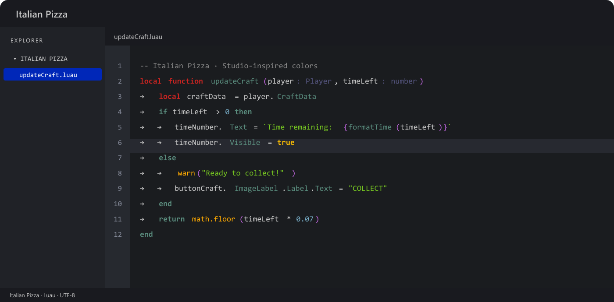

# Italian Pizza 🍕

A dark theme for **Visual Studio Code**, built from a supplied set of Studio
syntax-color references. Tomato-red declarations, basil-green strings, golden
built-ins, teal control flow and matching purple parentheses, brackets and braces.



## Install

Download `italian-pizza-1.0.1.vsix` from [Releases](https://github.com/KartzRbx/italian-pizza/releases/latest).
In VS Code, run **Extensions: Install from VSIX…**, select the file, then choose
**Preferences: Color Theme → Italian Pizza**. Or run:

```sh
code --install-extension italian-pizza-1.0.1.vsix
```

This is a color theme: it has no extension runtime, telemetry, network requests,
keybindings or grammar replacements. It also works in editors supporting VS Code
themes. It is distributed publicly on GitHub; a Marketplace listing is separate.

## Palette

| Role | Color |
| --- | --- |
| Editor | `#1A1C1F` |
| Panels | `#202227` |
| Text | `#CACACA` |
| Active line | `#272930` |
| Declarations (`local`, `function`) | `#CC2421` |
| Control flow and members | `#5A8D7E` |
| Strings | `#77C821` |
| Comments | `#878787` |
| Native functions | `#FFAA00` |
| Boolean values | `#FFC001` |
| Numbers | `#79B0CA` |
| Types (muted purple-gray) | `#55557F` |
| Parentheses, brackets and braces | `#C468E3` |

The Luau-specific scope for the `function` header is red; body control keywords
remain teal. All six VS Code bracket-pair colors use the same reference purple,
so enabling bracket-pair colorization does not introduce rainbow colors.
Semantic colors are supplied for language servers, including CL++.
Token classification depends on the language extension. Fonts, text smoothing,
transparency extensions and user color overrides can affect the visible result.
The theme preserves your font, layout, icons and editor preferences.

### Tab arrows

To show the indentation arrows from the reference, set:

```json
"editor.renderWhitespace": "all"
```

VS Code shows arrows for real tab characters and dots for spaces. The theme
colors those markers in a quiet gray; it does not rewrite your indentation.

## Develop

Edit `themes/italian-pizza-color-theme.json`. Test with `python tests/test_theme.py`
and package with `python tools/package.py`. No npm dependencies are required.
Open this folder in VS Code and press F5 for an isolated extension development host.

MIT · KartzRbx
